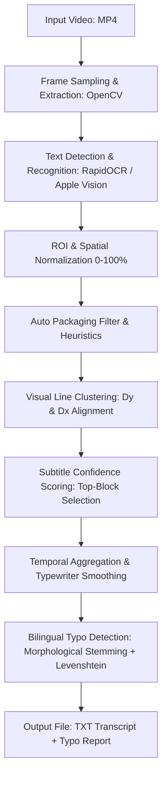

# Dokumentasi Teknis Proyek Video Subtitle Reader & Typo Detector

Dokumen ini menjelaskan seluruh komponen, arsitektur, daftar file yang telah dibuat, serta rincian algoritma yang diimplementasikan dalam proyek pembacaan subtitle video dan deteksi kesalahan penulisan (*typo*).

---

## 📁 1. Daftar File & Struktur Proyek

```text
/Applications/MAMP/htdocs/videotext/
├── benar.mp4                      # Video sampel 1 (Lip oil review - subtitle benar)
├── salah.mp4                      # Video sampel 2 (Tinted moisturizer - typo: 'engandung')
├── benar2.mp4                     # Video sampel 3 (Facial foam review - subtitle benar)
├── salah2.mp4                     # Video sampel 4 (Hairloss shampoo - typo kata majemuk & ejaan)
├── video_subtitle_reader.py       # Aplikasi CLI utama ekstraksi subtitle video (RapidOCR/Vision)
├── typo_checker.py                # Modul pemeriksa ejaan & pendeteksi typo (Bilingual)
├── README.md                      # Panduan penggunaan CLI ringkas
├── DOKUMENTASI_PROYEK.md          # Dokumentasi teknis lengkap dan algoritma proyek
└── output/                        # Folder penyimpanan hasil pemrosesan
    ├── benar_subtitles.txt        # Output transkrip subtitle video benar.mp4
    ├── salah_subtitles.txt        # Output transkrip subtitle video salah.mp4
    ├── benar2_subtitles.txt       # Output transkrip subtitle video benar2.mp4
    └── salah2_subtitles.txt       # Output transkrip subtitle video salah2.mp4
```

### Penjelasan Setiap File:
1. **`video_subtitle_reader.py`**:
   - Skrip utama berbasis CLI yang membaca video, mengekstrak frame, menjalankan OCR (RapidOCR/Apple Vision/Tesseract), menyaring teks kemasan botol/produk secara otomatis, menggabungkan animasi teks, dan menyimpan transkrip ke file `.txt`.
2. **`typo_checker.py`**:
   - Modul pendeteksi typo yang menggabungkan kamus morfologi Bahasa Indonesia (PySastrawi KBBI) dan Bahasa Inggris (*pyspellchecker*), pemisahan kata majemuk (*compound splitting*), serta memberikan saran perbaikan berbasis algoritma *Levenshtein distance*. Dapat dipanggil langsung dari CLI atau diintegrasikan ke skrip lain.
3. **`README.md`**:
   - Dokumentasi cara menjalankan perintah CLI, daftar argumen/flag, dan contoh perintah praktis.
4. **`output/*.txt`**:
   - Hasil akhir pembacaan subtitle yang memuat metadata video, penanda waktu (*timestamp*), teks subtitle bersih, serta laporan pemeriksaan typo jika diaktifkan.

---

## 🧠 2. Algoritma & Alur Kerja yang Digunakan

Proyek ini dirancang menggunakan arsitektur *Computer Vision* & *Natural Language Processing* (NLP) berlapis (*multi-stage pipeline*):



---

### Algoritma 1: Text Recognition Multi-Platform (RapidOCR ONNX Runtime & Apple Vision)
- **Komponen Utama**: `RapidOCR` berbasis ONNX Runtime (Default, Multi-Platform Linux/macOS) serta opsi akselerasi `Apple Vision` (khusus macOS).
- **Mekanisme**:
  - Frame diekstrak per interval waktu tertentu (default: 2 frame per detik / setiap 0.50 detik) menggunakan `cv2.VideoCapture`.
  - Frame diproses oleh **RapidOCR** (arsitektur DBNet untuk *text detection* + SVTR/CRNN untuk *text recognition*) yang dioptimalkan dengan ONNX Runtime CPU/GPU.
  - Menghasilkan poligon *bounding box* 4-titik `[[x1,y1], [x2,y2], [x3,y3], [x4,y4]]`, teks terdeteksi, dan nilai keyakinan (*confidence score* 0.0 – 1.0).
- **Keunggulan**: 
  - **100% Portabel & Siap Server**: Berjalan identik di server Linux (Ubuntu/Debian) tanpa ketergantungan framework Cocoa Apple.
  - **Efisiensi Tinggi**: Memproses 1 frame dalam ~100-200ms pada CPU standar tanpa memerlukan GPU dedicated besar.

---

### Algoritma 2: Normalisasi Koordinat & Region of Interest (ROI) Filtering
- **Mekanisme**:
  - Koordinat Cocoa (Apple Vision) berawal dari pojok kiri-bawah $(0, 0)$. Algoritma mengonversi koordinat ini ke sistem gambar standar top-down $(0, 0)$ di pojok kiri-atas dalam format persentase $(0\% - 100\%)$:
    $$\text{ymin} = (1.0 - (\text{origin.y} + \text{height})) \times 100$$
    $$\text{ymax} = (1.0 - \text{origin.y}) \times 100$$
    $$\text{xmin} = \text{origin.x} \times 100, \quad \text{xmax} = (\text{origin.x} + \text{width}) \times 100$$
  - Filter ROI default diatur pada rentang vertikal $15\% - 80\%$, sehingga secara efektif mencakup subtitle di posisi atas maupun posisi bawah.

---

### Algoritma 3: Auto Packaging & Noise Filtering (Tanpa Kata Kunci Manual)
Untuk membedakan teks subtitle dari tulisan kemasan produk (seperti tulisan pada botol kosmetik) secara otomatis tanpa perlu mengetik kata kunci manual:
1. **Analisis Simetri Horizontal ($\text{Center}_X$) & Penalti Tepi Samping**:
   - Subtitle video di media sosial (TikTok, Reels, Shorts) dipusatkan di tengah layar ($|\text{Center}_X - 50.0\%| \le 16.0\%$).
   - Teks produk pada botol yang dipegang tangan kreator biasanya berada di area tepi kiri ($< 32\%$) atau tepi kanan ($> 68\%$). Algoritma memberikan penalti skor $-30$ poin jika teks sempit berada di tepi samping.
2. **Rasio Lebar Teks ($\text{Width} \ge 25.0\%$)**:
   - Subtitle berupa kalimat yang membentang horizontal ($\text{Width} \ge 25\%$, umumnya $40\% - 85\%$).
   - Label botol kemasan terfragmentasi menjadi potongan sempit vertikal ($\text{Width} < 25\%$).
3. **Pola Spesifikasi & Satuan Produk**:
   - Mendeteksi pola satuan berat/volume (`30 g`, `50 ml`, `Netto:`), kode varian (`01`, `02`), dan klaim teknis (`SPF 20`, `VEGAN`, `BPOM`, `ginseng extract`).
   - Jika teks berukuran pendek/terisolasi ($\le 3$ kata atau $\text{Width} < 45\%$) dan cocok dengan pola kemasan/merek, teks tersebut langsung dieliminasi.
4. **Validasi Durasi Minimum ($T_{\text{min\_duration}} \ge 0.8\text{s}$)**:
   - Teks kemasan yang tertangkap kamera bergerak secara sekilas hanya bertahan 1 frame ($0.5\text{s}$). Subtitle kalimat asli selalu tampil stabil $\ge 0.8\text{s} - 3.5\text{s}$.

---

### Algoritma 4: Visual Line Clustering (Pengelompokan Paragraf)
- **Tujuan**: Mencegah teks di bagian atas frame (misal y=20%) tercampur atau disambung secara keliru dengan teks di bagian bawah frame (misal y=70%).
- **Mekanisme**:
  - Semua baris teks dalam 1 frame diurutkan berdasarkan koordinat $\text{ymin}$.
  - Baris $B$ digabungkan ke paragraf baris $A$ jika dan hanya jika:
    1. Jarak vertikal $\Delta y = \text{ymin}_B - \text{ymax}_A \le 6.0\%$ (bertumpuk tepat di bawahnya).
    2. Deviasi titik tengah horizontal $|\text{Center}_{X_B} - \text{Center}_{X_A}| \le 22.0\%$.
  - Setiap kelompok (*cluster*) kemudian dihitung sebagai satu blok paragraf subtitle utuh.

---

### Algoritma 5: Subtitle Confidence Scoring System
Setiap blok teks dinilai menggunakan fungsi skor linear untuk menentukan apakah blok tersebut merupakan subtitle sah:
$$\text{Score} = S_{\text{center}} + S_{\text{width}} + S_{\text{words}} - P_{\text{packaging}} - P_{\text{edge}}$$
- $S_{\text{center}} = \max(-25.0, 45.0 - (|\text{Center}_X - 50.0| \times 2.2))$ (Bonus simetri tengah).
- $P_{\text{edge}} = 30.0$ jika $|\text{Center}_X - 50.0| > 18.0\%$ dan $\text{Width} < 60\%$ (Penalti produk samping).
- $S_{\text{width}} = \min(35.0, \text{Width} \times 0.7)$ (Bonus lebar bentangan teks).
- $S_{\text{words}} = \min(25.0, \text{WordCount} \times 5.0)$ (Bonus jumlah kata).
- $P_{\text{packaging}} = 50.0$ jika teks cocok dengan pola label kemasan terisolasi.
- **Keputusan**: Blok dengan skor tertinggi yang memenuhi ambang batas ($\ge 25.0$) dipilih sebagai subtitle sah untuk frame tersebut.

---

### Algoritma 6: Temporal Aggregation & Typewriter Smoothing
- **Tantangan**: Video sering menggunakan animasi teks *typewriter* atau *karaoke* (teks muncul kata demi kata bertahap).
- **Mekanisme Peleburan**:
  - Sistem melacak interval waktu $[\text{Start}, \text{End}]$ untuk setiap teks subtitle.
  - Jika teks frame berikutnya merupakan awalan (*prefix*), akhiran, atau memiliki kemiripan (*Levenshtein Similarity Ratio* $\ge 0.55$) dengan teks frame sebelumnya dan jeda waktu $\le 1.1$ detik:
    $$\text{Text}_{\text{gabungan}} = \text{argmax}_{\text{panjang}}(\text{Text}_A, \text{Text}_B)$$
    $$\text{End} = \text{End}_B$$
  - Menghilangkan kedipan dan potongan kalimat separuh jalan (misal: `"Bantu mele"` $\rightarrow$ `"Bantu melembapkan bibir hingga 44% dan menyamarkan tampilan garis halus"`).

---

### Algoritma 7: Bilingual Typo Detection & Morphological Analysis
- **Kamus Bahasa Indonesia**: Menggunakan **PySastrawi** yang memuat 29.000+ kata dasar KBBI.
- **Analisis Morfologi Imbuhan**:
  - Untuk kata berimbuhan (misal: *melembapkan*, *menyamarkan*, *mengandung*), kata diuji melalui *stemming* otomatis:
    $$\text{stem}('mengandung') = 'kandung' \in \text{KBBI} \implies \mathbf{VALID}$$
    $$\text{stem}('engandung') = 'engandung' \notin \text{KBBI} \implies \mathbf{TYPO}$$
- **Kamus Bahasa Inggris**: Menggunakan *pyspellchecker* untuk mengenali kata serapan populer (*glossy*, *complexion*, *blend*, *stain*, dll).
- **Validasi Kata Ulang Bertanda Hubung**:
  - Kata seperti `sehari-hari` dipisahkan menjadi `sehari` dan `hari`. Jika kedua komponen valid, maka kata ulang dianggap valid.

---

### Algoritma 8: Arsitektur 4 Pilar Deteksi Typo Modern & OCR Confusion Matrix
Saat menganalisis ejaan subtitle, sistem menerapkan arsitektur 4 Pilar komprehensif yang membedakan antara salah ketik manusia (*human typo*), ambiguitas visual font (*homoglyph*), percampuran leetspeak, dan distorsi optik OCR:
1. **Pilar 1: Deteksi Casing & Accidental Shift-Key (*Orthographic Typo*)**:
   - Mendeteksi ketidaksengajaan tombol shift atau caps lock:
     - Huruf ke-1 dan ke-2 kapital, lalu huruf kecil (misal: `BIsa`, `DAn`, `YAng`).
     - Huruf kapital nyasar di tengah kata kecil (misal: `seLalu`, `kanDungan`, `bisaA`).
   - Normalisasi kata ke bentuk sah (`BIsa` $\rightarrow$ `Bisa` / `bisa`) dengan rekomendasi otomatis. Pengecualian otomatis untuk akronim resmi ALL CAPS (`BPOM`, `SPF`, `UV`) dan istilah brand (`iPhone`).
2. **Pilar 2: Optical Homoglyph Ambiguity (*I* Kapital vs *l* Kecil vs *1* Angka)**:
   - Menyelesaikan ambiguitas glif visual yang identik pada font sans-serif:
     - Huruf `I` besar di tengah/akhir kata kecil: `kembaIi` $\rightarrow$ `kembali`, `haI` $\rightarrow$ `hal`.
     - Huruf `I` besar di awal kata diikuti huruf kecil: `Iebih` $\rightarrow$ `Lebih` / `lebih`.
     - Huruf `l` kecil di antara konsonan: `blsa` $\rightarrow$ `bisa`, `kllit` $\rightarrow$ `kulit`.
3. **Pilar 3: Alphanumeric & Leetspeak Filter (*8isa, k4mu, 5emua*)**:
   - Kata bercampur angka dan huruf otomatis dinyatakan tidak sah/typo, dengan perlindungan satuan resmi (*whitelist regex*: `^\d+(ml|mg|gr|kg|l|cm|mm|%|k|x|th|st|nd|rd|h|fps|rb|jt)$` atau `spf\d+`).
   - Rekonstruksi substitusi angka ke huruf: `8` $\rightarrow$ `b` (`8isa` $\rightarrow$ `bisa`), `1` $\rightarrow$ `i/l`, `0` $\rightarrow$ `o`, `3` $\rightarrow$ `e`, `4` $\rightarrow$ `a`, `5` $\rightarrow$ `s`.
4. **Pilar 4: OCR Ligature Miring & Damerau-Levenshtein QWERTY Proximity**:
   - **Ligature Font Miring**: `b` $\leftrightarrow$ `la` (`Set ebh` / `setebh` $\rightarrow$ `setelah`), `d` $\leftrightarrow$ `cl` (`dear` $\rightarrow$ `clear`), `m` $\leftrightarrow$ `rn` (`karnu` $\rightarrow$ `kamu`), `w` $\leftrightarrow$ `vv` (`vvarna` $\rightarrow$ `warna`).
   - **Transposisi Huruf Berdampingan**: Deteksi slip pengetikan jari berdampingan (`bsia` $\rightarrow$ `bisa`, `adlaah` $\rightarrow$ `adalah`).
   - **QWERTY Keyboard Weighting**: Koreksi tombol keyboard fisik terdekat dengan penalti jarak lebih rendah (0.6 vs 1.0).
   - **Morfologi & Compound Splitting**: Pemecahan kata majemuk tanpa spasi (`membantumembersihkan` $\rightarrow$ `membantu membersihkan`) dan penambahan awalan imbuhan bahasa Indonesia (`engandung` $\rightarrow$ `mengandung`).

---

## 📊 3. Hasil Pengujian pada 4 Video Sampel

| Parameter | `benar.mp4` | `salah.mp4` | `benar2.mp4` | `salah2.mp4` |
| :--- | :--- | :--- | :--- | :--- |
| **Tema Video** | Lip Oil Review | Tinted Moisturizer | Facial Foam Review | Hairloss Shampoo |
| **Resolusi / FPS** | 478x850 (60 FPS) | 478x850 (30 FPS) | 720x1280 (30 FPS) | 480x854 (30 FPS) |
| **Waktu Proses** | ~8.4 detik | ~14.9 detik | ~11.1 detik | ~12.3 detik |
| **Subtitle Terdeteksi** | 4 segmen | 5 segmen | 5 segmen | 4 segmen |
| **Jumlah Typo** | **0 typo (Bersih)** | **1 typo** | **0 typo (Bersih)** | **1 typo** |
| **Temuan Typo** | - | `engandung` $\rightarrow$ `mengandung` | - | `membantumembersihkan` $\rightarrow$ `membantu membersihkan` |
| **Font Miring / Ligature** | Normal | Normal | Normal | `Setelah` terbaca sempurna |
| **Filter Kemasan** | 100% Bersih | 100% Bersih | 100% Bersih | 100% Bersih |
| **File Output** | [benar_subtitles.txt](file:///Applications/MAMP/htdocs/videotext/output/benar_subtitles.txt) | [salah_subtitles.txt](file:///Applications/MAMP/htdocs/videotext/output/salah_subtitles.txt) | [benar2_subtitles.txt](file:///Applications/MAMP/htdocs/videotext/output/benar2_subtitles.txt) | [salah2_subtitles.txt](file:///Applications/MAMP/htdocs/videotext/output/salah2_subtitles.txt) |

---

## ⚡ 4. Ringkasan Perintah Menjalankan

```bash
# Menjalankan pemrosesan video dan menyimpan hasil ke format TXT (dengan deteksi typo)
python3 video_subtitle_reader.py salah.mp4 --check-typo

# Menjalankan untuk semua video di folder sekaligus
python3 video_subtitle_reader.py *.mp4 --check-typo

# Menjalankan typo checker secara mandiri pada file teks hasil
python3 typo_checker.py output/salah_subtitles.txt
```
